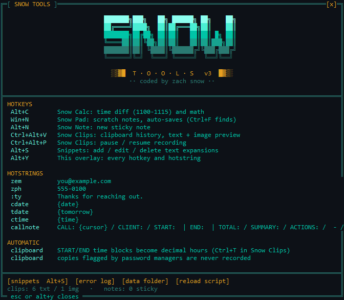
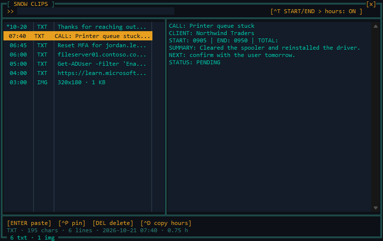
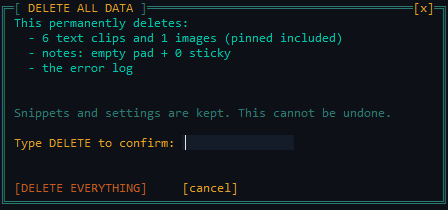
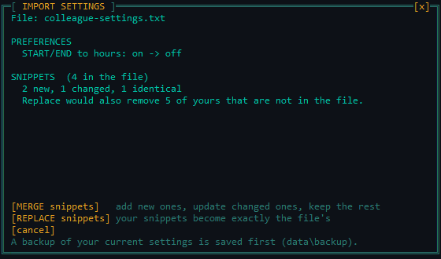
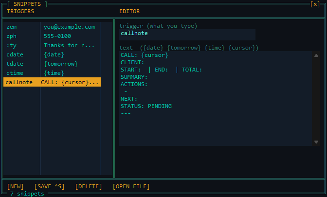
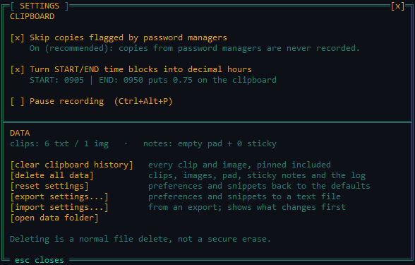

# Snow Tools

**A keyboard-driven toolkit for Windows service desk work: clipboard history, text snippets, scratch notes and a call-time calculator, in under 3,000 lines of AutoHotkey v2.**

[](https://github.com/ZachGSnow/snow-tools/actions/workflows/ci.yml)
[](LICENSE)



## Why

Service desk work is a stream of small repeats: paste the same wording into another ticket, find the thing you copied an hour ago, work out how long a call ran for billing. Each one costs a few seconds and a bit of focus. Snow Tools removes those costs with a handful of small tools that live in the tray, store everything in plain local files, and describe themselves: press **Alt+Y** and the overlay lists every hotkey and hotstring, generated from the code, so the list cannot drift out of date.

## Features

| Key | Tool | What it does |
|---|---|---|
| Alt+Y | HUD | Every hotkey, hotstring and automatic behavior, plus shortcuts to snippets, the error log and the data folder |
| Ctrl+Alt+V | Snow Clips | Clipboard history: 10,000 text clips and 200 images, search, text and image preview, pin, delete, paste |
| Ctrl+Alt+P | Pause | Stops and resumes clipboard recording |
| Alt+S | Snippets | Add, edit and delete text expansions in an editor; changes apply immediately, no reload |
| Ctrl+Alt+S | Settings | Clipboard options (password guard, time-block conversion, pause), the buttons that delete your data, and settings export and import |
| Win+N | Snow Pad | One scratch note that autosaves every 5 seconds; Ctrl+F finds |
| Alt+N | Sticky notes | As many small notes as you like, each remembering its place and size |
| Alt+C | Snow Calc | `1100-1115` gives 0.25 hours, `9:30-17:05` gives 7.58, and plain arithmetic works too |

Details worth knowing:

- **Time blocks become hours.** Copy a line such as `START: 0905 | END: 0950` and Snow Clips puts `0.75` on the clipboard (toggle with Ctrl+T in the clips window). The `callnote` snippet types a template with that line already in it.
- **Snippets are plain text.** `data\snippets.txt` holds one `trigger = text` per line. Tokens `{date}`, `{tomorrow}`, `{time}` and `{cursor}` are filled in as you type. The editor warns when one trigger is the start of another, since the longer one could then never fire.
- **Windows are drawn on a character grid.** Every window uses the same monospace frame, which gives the whole toolkit its keygen-era look and keeps the code for each tool small.



## Quick start

1. Install [AutoHotkey v2](https://www.autohotkey.com/) (v2.0 or later; tested on 2.0.28 on Windows 11).
2. Download or clone this repository.
3. Double-click `hotstrings.ahk` (it is the entry point; the name is kept so older startup shortcuts keep working).
4. Press **Alt+Y**. To start it at login, right-click the tray icon and tick **Run at startup**.

## Your data and privacy

Everything stays on your machine. The code has no network access at all. Runtime data is created next to the script in `data\` (git-ignored):

| File | Contents |
|---|---|
| `clips.log` | Text clips, **as plain text** |
| `img\`, `images.idx` | Clipboard images as PNG files, and their index |
| `snippets.txt` | Your snippets |
| `quicknotes.txt`, `stickies` | Snow Pad and sticky notes |
| `prefs.ini` | Small preferences |
| `snowtools.log` | Errors only, capped near 1 MB |

A clipboard history is sensitive by nature, so:

- **Password managers are respected, by default.** A copy flagged with `ExcludeClipboardContentFromMonitorProcessing` (the flag KeePass, Bitwarden, 1Password and others set) or `CanIncludeInClipboardHistory = 0` is not recorded. If the flag is present but cannot be read, the copy is skipped. This is a setting (Ctrl+Alt+S) that is on out of the box; turning it off asks you to confirm and the window then says so in red.
- **Pause with Ctrl+Alt+P** before copying anything you do not want kept. It is not remembered across restarts: every start records again.
- **Delete from Settings (Ctrl+Alt+S).** *Clear clipboard history* removes every clip and image, pinned included, after a Yes/No confirmation that shows the counts. *Delete all data* also removes the pad, sticky notes and the error log, and only proceeds once you type `DELETE`. Snippets and preferences are kept; *Reset settings* returns those to the defaults. A single clip is deleted with Delete in the clips window.
- Nothing is encrypted, and deleting is an ordinary file delete, not a secure erase: on an SSD the old data may linger until the drive overwrites it. Anyone who can read your profile folder can read the history.



## Moving your settings

Settings has **export settings** and **import settings** buttons. An export is one plain-text file with your preferences and snippets (clips and notes are data, not settings, and are never exported). It is meant to be read: open it in any editor. Because snippets can contain private text, look at an export before you share it.

Importing is treated as untrusted input. The file is parsed strictly (known preferences only, valid triggers only, a 1 MB limit) and nothing changes until you have seen a summary of what would: preferences that change, how many snippets are new, changed or identical, and anything that was skipped. You then choose **merge** (add new snippets, update changed ones, keep the rest) or **replace** (your snippets become exactly the file's; refused if the file has none). Your current settings are saved to `data\backup\` first (the newest 10 are kept), and everything applies immediately. A file that would turn the password-manager guard off does not do so unless you tick a separate, red opt-in line in the dialog.



## Configuration

| Setting | Where |
|---|---|
| Snippets | Alt+S, or edit `data\snippets.txt` and choose Reload from the tray menu |
| Move or back up settings | Export and import in Ctrl+Alt+S (see above); automatic backups in `data\backup\` |
| Password-manager guard, START/END to hours, pause | Ctrl+Alt+S (also in the HUD and the tray menu). Preferences are saved in `data\prefs.ini`; Ctrl+T in the clips window also toggles START/END |
| Clip limits | `CLIP_MAX_TEXT`, `CLIP_MAX_IMG`, `CLIP_MAX_CHARS` at the top of `lib\clipstore.ahk` |
| Colors and font | The `THEME_*` constants at the top of `lib\theme.ahk` |

The defaults the first run seeds (`zem`, `zph`, `:ty`, `cdate`, `tdate`, `ctime`, `callnote`) use placeholder values such as `you@example.com`; replace them with your own.

## How it works

`hotstrings.ahk` only lists includes. Shared code is in `lib\`, one tool per file in `features\`. Each tool registers its hotkeys through a single registry that the HUD reads, windows are built on a shared character-grid class, and the clipboard store is an append-only journal with caps. [ARCHITECTURE.md](ARCHITECTURE.md) covers the design and how to add a tool.





## Testing

```powershell
pwsh -File tests\run-tests.ps1                 # syntax check + self-test (about 40 s)
pwsh -File tests\run-tests.ps1 -Showcase       # regenerate the screenshots in docs\
```

The self-test copies the project to a temp folder, so your clips, snippets, notes and Startup folder are never touched. It opens real windows, types into a scratch window and briefly uses the clipboard (restored afterwards), so leave the machine alone while it runs. It covers the clipboard store (dedupe, pinning, caps, journal round-trip), the privacy guard and its setting (a flagged copy is skipped, recorded when the guard is off, pause works), the settings and delete actions (both confirmations are answered for real: declining keeps the data, and the wrong word deletes nothing), settings export and import (strict parsing, the summary dialog, merge and replace, the backup, and the privacy opt-in), the snippet engine and editor, the calculator, notes, window placement, logging, and a 10,000-clip performance check.

Verified: Windows 11 with AutoHotkey 2.0.28. Not verified: Windows 10, mixed-DPI multi-monitor setups, and non-US keyboard layouts (hotstrings and `Send` can behave differently there).

## License

[MIT](LICENSE) &copy; Zach Snow
